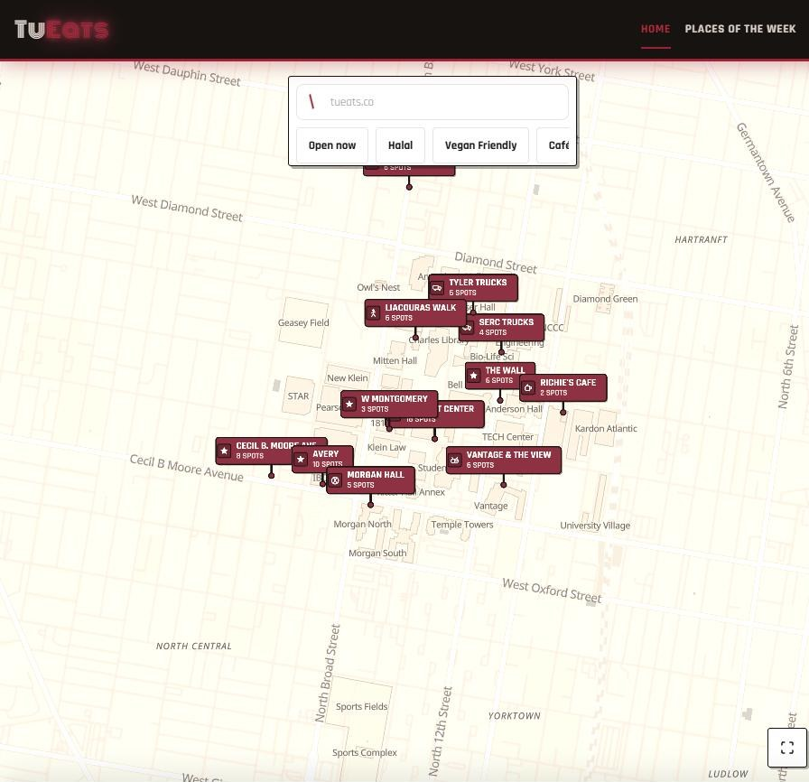

# TuEats

**Every off-meal-plan food option around Temple University's main campus, on one map.**

[](https://github.com/abislam66/fun-proj/actions/workflows/ci.yml)


**Live site:** [tueats.co](https://tueats.co)



---

## The problem

Food trucks are a big part of eating at Temple, but the only official directory is a prose page with an embedded Google My Map. It has no list view, no hours, no cuisine info, and it doesn't work well on a phone. Restaurants and cafes are scattered across Google and Yelp, with nothing scoped to campus.

TuEats puts all of it in one mobile-first place: an interactive campus map, search and filters, opening hours, and ratings and reviews from students.

## Features

- **Interactive campus map** built with MapLibre GL. Venues are grouped into campus zones (Liacouras Walk, The Wall, Morgan Hall, Cecil B. Moore Ave, and more), and each venue has a cuisine-coded pin.
- **Search with fly-to.** Type a venue name and the map jumps to it.
- **Filters:** *Open now*, Halal, Vegan friendly, and cuisine/venue type.
- **"Open now"** is computed in the browser from each venue's wall-clock hours (`America/New_York`), so public pages can stay static and fast.
- **Member accounts** via Google sign-in. Members get a private account page and can rate venues 1–5 stars, write reviews, and submit photos for approval.
- **Places of the Week**, a ranking based on member ratings.
- **Report a problem** on any venue (closed, wrong hours, moved). The reporter's IP is hashed, never stored raw.
- **Admin dashboard** for managing venues: create and edit venues, a draft → published → retired lifecycle, a multi-photo gallery, zone assignment, bulk cuisine tagging, and moderation queues for photos and reports.

## Tech stack

| Layer      | Technology                                                    |
| ---------- | ------------------------------------------------------------- |
| Framework  | Next.js 15 (App Router), React 19, TypeScript (strict)        |
| Styling    | Tailwind CSS 4, Framer Motion                                 |
| Maps       | MapLibre GL JS + OpenFreeMap vector tiles (no API key needed) |
| Database   | PostgreSQL on Supabase, accessed with Drizzle ORM             |
| Auth       | Supabase Auth: Google OAuth for members, email/password for admins |
| Validation | Zod 4                                                         |
| Storage    | Vercel Blob (venue photos)                                    |
| Hosting    | Vercel, with preview deploys on every pull request            |
| Testing    | Vitest (unit), Playwright (end-to-end)                        |
| CI         | GitHub Actions: typecheck, lint, format, tests, build         |

## Architecture

TuEats is a single Next.js app with no separate backend service.

```
Browser ──► Next.js server components (reads, static/ISR + tag caching)
        └─► Server actions (writes) ──► validate (Zod) ──► authorize ──► rate-limit ──► Drizzle ──► Postgres
                                                                                              │
                                                                       revalidateTag("venues") ◄┘
```

Design decisions:

- **One write path.** Every mutation is a server action that validates, then authorizes, then rate-limits, then writes, then invalidates the cache. The browser never talks to the database directly, and Supabase's auto-generated REST API is locked down with deny-all row-level security.
- **Server-only data access.** Only `src/lib/db/queries/` imports the database client. The Supabase JS client is used for authentication only.
- **Venue-generic data model.** "Truck" is just a value of `venue.type`. Tables, routes (`/eat/[slug]`), and components never name a specific venue type, so restaurants, cafes, and vending machines can be added without a migration.
- **Event-driven caching.** Pages are cached by tag (`venues`, `venue:{slug}`) and refreshed exactly when an admin or member write changes them. There are no timers or cron jobs.
- **Authentication ≠ authorization.** Signing in only proves who you are. Admin access additionally requires `role = "admin"` on the user's profile row, which can only be set directly in the database.
- **Privacy by default.** Reviews show only a display name. Raw IPs are never stored (salted hashes only), user geolocation never leaves the browser, and user content is rendered as plain text.

## Project structure

```
src/
  app/            Routes: public map, /eat/[slug], /account, /about, /admin
  actions/        Server actions (the only way data is written)
  components/     UI, grouped by feature (map, venues, reviews, admin, …)
  lib/            Business logic: hours, ratings, validation, rate limiting
    db/queries/   All database reads and writes (Drizzle)
drizzle/          SQL migrations
scripts/          Data seeding and enrichment (KML import, venue enrichment)
tests/e2e/        Playwright tests
Specs/            Software design documents (scope, architecture, security, deployment)
Context/          Design system, decision log, progress log, backlog
docs/             Design notes and screenshots
```

## Getting started

**Prerequisites:** Node.js 22+, pnpm 10, and a Supabase project.

```bash
git clone https://github.com/abislam66/fun-proj.git
cd fun-proj
pnpm install
cp .env.example .env.local   # then fill in your Supabase values
pnpm db:migrate              # apply database migrations
pnpm seed:kml                # optional: seed venues from TuEats.kml
pnpm dev                     # http://localhost:3000
```

### Scripts

| Command             | What it does                    |
| ------------------- | ------------------------------- |
| `pnpm dev`          | Start the dev server            |
| `pnpm build`        | Production build                |
| `pnpm typecheck`    | TypeScript type check           |
| `pnpm lint`         | ESLint                          |
| `pnpm format:check` | Prettier check                  |
| `pnpm test`         | Unit tests (Vitest)             |
| `pnpm test:e2e`     | End-to-end tests (Playwright)   |
| `pnpm db:generate`  | Generate a migration from the schema |
| `pnpm db:migrate`   | Apply migrations                |

## Quality and workflow

- Changes reach `main` through pull requests. `main` is protected, and CI must pass before merging.
- CI runs the typecheck, ESLint, the Prettier check, the Vitest suite, and a full production build on every PR.
- Every PR gets its own Vercel preview deployment, and merging to `main` deploys to production.
- Larger decisions are recorded in [`Context/decisions.md`](Context/decisions.md), and the full design docs live in [`Specs/`](Specs/).

## Team

- **Abrar Islam** ([@abislam66](https://github.com/abislam66))
- **Rafiat Amir** ([@templeterror](https://github.com/templeterror))

## Disclaimer

TuEats is an independent student project and is **not affiliated with or endorsed by Temple University**.

## License

[MIT](LICENSE)
